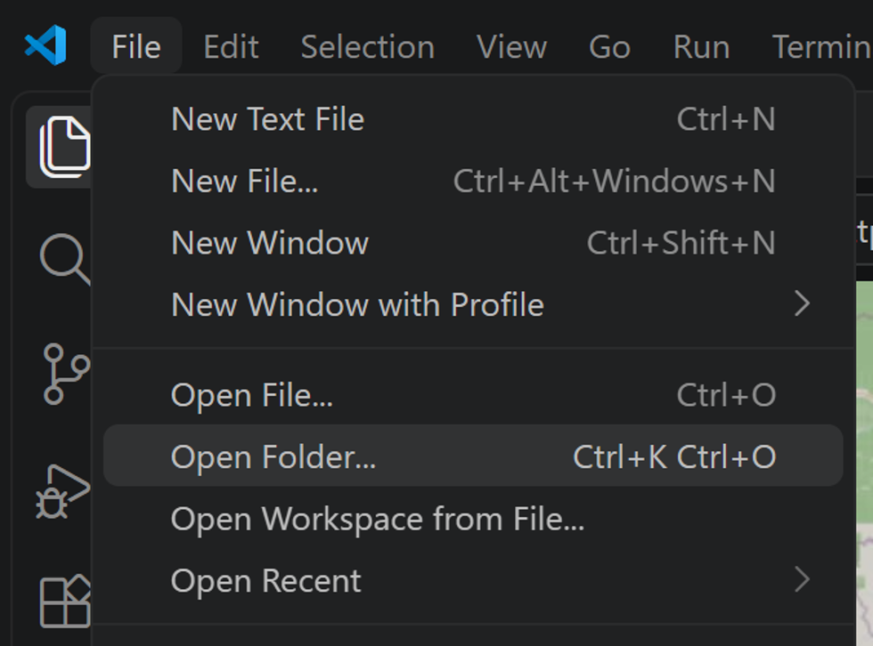
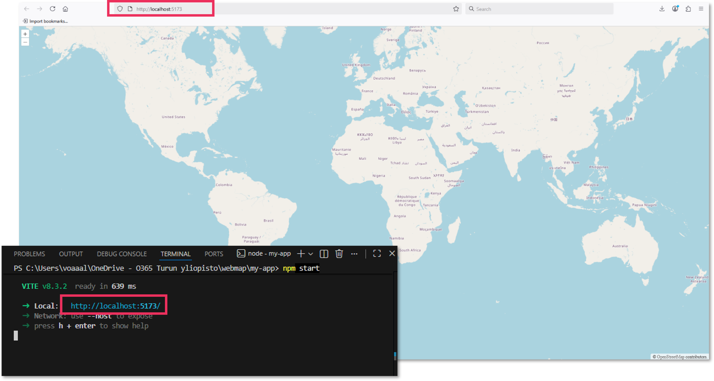

In this chapter, you will set up your project and run a basic OpenLayers map on your own device. By the end, you should have a working local webmap and know which files control its structure, behaviour and appearance.

## 1.1. Install required software

You will need:

- **A code editor.** This tutorial uses [Visual Studio Code](https://code.visualstudio.com/).
- [**Node.js**](https://nodejs.org/en)(14 or higher), which includes *npm*, the package manager used to install project dependencies.
- [**Git**](https://git-scm.com/downloads), which is useful for version control and working with GitHub.

Follow the installation instructions on the official websites. If you already have these tools installed, proceed to the next task!

::: {.callout-note}
Screenshots in this tutorial show Visual Studio Code interface. Other code editors work too, but menus and terminal locations may differ. No extensions are used in this tutorial, but if you like to use any, feel free to use them as you like.
:::

## 1.2. Create a project folder

- [ ] Create a folder on your computer for the webmap project. Call it `webmap`, or choose another name. Cloud locations work too.
- [ ] Open your code editor and open that folder using **File → Open Folder…**

You will keep all your webmap code and data layers in this project folder.

## 1.3. Create the OpenLayers application

Follow the [OpenLayers Quick Start guide](https://openlayers.org/doc/quickstart.html) to create a basic OpenLayers application.

- [ ] Open a terminal in your code editing software, often via **Terminal → New Terminal**. 
- [ ] Check that the terminal is working in your project folder before running commands (the terminal path should end with `...\webmap`) 
- [ ] Follow the Quick Start instructions in order to run the needed commands. If a command fails, read the terminal message for a possible solution. Make sure that Node.js is installed and that the terminal is running in your project folder.

After successful run of the final command `npm start`, the terminal should display a local development server address, often `http://localhost:5173/`. Open that address in your browser. You should see a world map with OpenStreetMap base. **This development server allows you to test your changes locally while you work.** The map is not yet published online, and you cannot share the URL to anyone to see your webmap outside your local device.

::: {.callout-tip}
If you are working with e.g. Notepad++, [this forum](https://community.latenode.com/t/setting-up-npm-packages-while-using-notepad-need-guidance/36503) discusses how to use the `npm` terminal commands.
:::

## 1.4. Explore the project files

You will work with three main files:

- `index.html` defines the page structure and contains the map container.
- `main.js` contains the JavaScript that creates the map and adds layers and controls.
- `style.css` controls the appearance and layout of the page.

Each of the files above already contain some code, so you won't have to start from scratch.

::: {.callout-warning}
**Do not open `index.html` directly from your file explorer as your main way of testing the map.** Use the local development server instead. Some web resources and JavaScript modules require a server, and direct file access can cause errors. For example, the OpenStreetMap tile service has updated its usage policies to avoid unnecessary requests to its volunteer-run servers, which leads to blocked tiles when opening the `index.html` directly from you file explorer. Read more: [https://wiki.openstreetmap.org/wiki/Blocked_tiles](https://wiki.openstreetmap.org/wiki/Blocked_tiles).
:::

::: {.callout-note}
## Checkpoint

Before continuing, make sure that:

- The project folder is open in your code editor.
- The development server starts without errors.
- The local webmap opens in your browser and displays a basemap.
- You can locate `index.html`, `main.js` and `style.css`.

If the map does not appear, check the terminal for error messages before proceeding.
:::

[Next: Add a WMS layer →](02-wms-layer.qmd)

