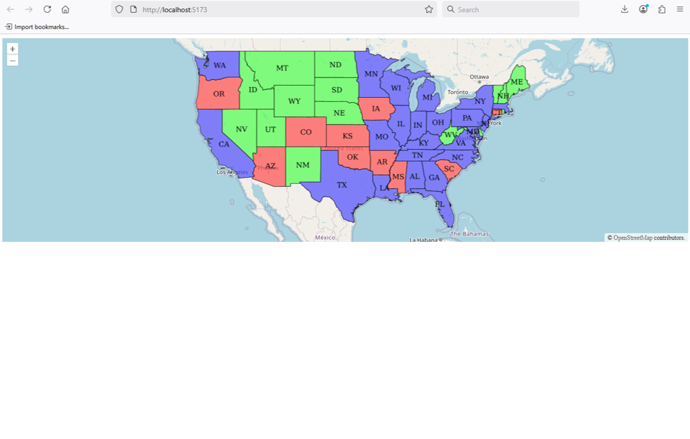
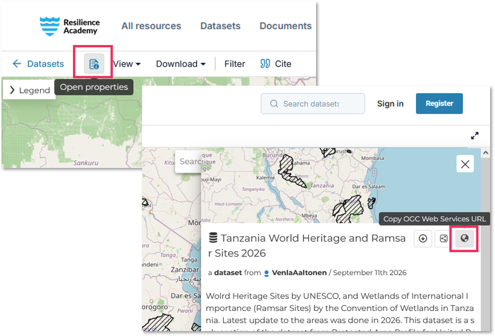
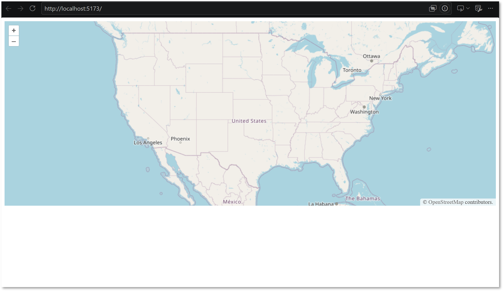

In this chapter, you will add a geospatial data layer to your webmap using **Web Map Service (WMS)**.

WMS delivers rendered map images from a remote location, such as **GeoServer**. Instead of downloading and displaying the original vector features in your browser, OpenLayers requests map images from the server over the web based on parameters you define.

**We will start from an existing OpenLayers example and adapt it to display protected areas in Tanzania.**


## 2.1. Start with an OpenLayers example

- [ ] Open the official [Single Image WMS example](https://openlayers.org/en/latest/examples/wms-image.html).
- [ ] Review its `index.html` and `main.js` files.
- [ ] Copy the code from those files, and paste them into the corresponding files in your project.
- [ ] Save both files and view the changes in the local development server address (`http://localhost:XXXX/`).

Your map should now be exactly as the [Single Image WMS](https://openlayers.org/en/latest/examples/wms-image.html) example, which displays US states data.

::: {.callout-note}
When working with OpenLayers webmap projects, the official OpenLayers repositories contain great resources to develop different functionalities for the map. [Examples](https://openlayers.org/en/latest/examples/) and the [Workshop](https://openlayers.org/workshop/en/) are useful starting points to search for code.
:::




## 2.2. Find the Tanzanian WMS layer

For this tutorial, we will replace the US states WMS layer with **Tanzania World Heritage and Ramsar Sites 2026** layer from the [Climate Risk Database](https://crd.resilienceacademy.ac.tz/).

- [ ] Open the [dataset page](https://crd.resilienceacademy.ac.tz/catalogue/#/dataset/1102).
- [ ] Choose **Open properties** and copy the **OGC Web Services URL**.
- [ ] Paste the URL temporarily into a text editor or at the end of your `main.js` file so you can examine it (if latter, remember to delete later).




The service URL contains several pieces of information. For this layer, the relevant parts are:

- `https://crd.resilienceacademy.ac.tz/geoserver/`, the GeoServer address.
- `geonode:tanzania_international_conservation_areas_2026`, the workspace and layer name.
- `/ows`, a general Open Geospatial Consortium web-services endpoint. In our OpenLayers code, we will request the layer using WMS, which brings the layer as an image that is light-weight for a webmap to read and render.


## 2.3. Replace the example WMS connection

In `main.js`, find the existing `ImageLayer` configuration. It should resemble this:

```javascript
new ImageLayer({
  extent: [-13884991, 2870341, -7455066, 6338219],
  source: new ImageWMS({
    url: 'https://ahocevar.com/geoserver/wms',
    params: {'LAYERS': 'topp:states'},
    ratio: 1,
    serverType: 'geoserver',
  }),
}),
```

- [ ] Replace the **service URL and Web Service endpoint** (use `/wms`), the **workspace** and **layer name** to our Tanzanian dataset.


## 2.4. Change extent

In addition to the correct connection parametres, **you still need to change the `extent` parameter coordinates to match the extent of the new layer.** Often, these coordinates can be extracted from GeoServer, or approximated e.g. in Google Maps or QGIS. The coordinates represent the top-left and bottom-right corner of a bounding box that covers the data layer.

::: {.callout-note}
The extent must use the same coordinate reference system as the webmap view. Default coordniate system of OpenLayers webmaps is WGS84 (EPSG:4326), and fortunately, our layer is in the same CRS.
:::

- [ ] Replace the extent of US States layer to our Tanzanian layer with the correct coordinates: `extent: [3228700, -1381359, 4567834, -162868]`
- [ ] Save `main.js` and view the changes on your local webmap.

The map is still centred on the United States. That is expected: you have changed the layer, but not the initial map view. Pan to Tanzania to check whether the new layer appears. We will centre the map on Tanzania in the next chapter.





### View full edited code:
<details>
<summary>Expand to view `main.js` code with edits</summary>

```javascript
new ImageLayer({
    extent: [3228700, -1381359, 4567834, -162868], // Changed extent coordinates
    source: new ImageWMS({
      url: 'https://crd.resilienceacademy.ac.tz/geoserver/wms', // URL to correct GeoServer and Web Service (WMS)
      params: {'LAYERS': 'geonode:tanzania_international_conservation_areas_2026'}, // Correct workspace and layer file name
      ratio: 1,
      serverType: 'geoserver',
    }),
  }),
```
</details>


::: {.callout-note}
## Checkpoint

Before continuing, confirm that:

- The original US states layer configuration has been replaced.
- The new WMS service URL and layer name are correct.
- The layer appears when you navigate to Tanzania.
- The application runs without JavaScript errors.

If the new layer does not appear when you pan the map on Tanzania, check the WMS connection URL, layer name, and extent.
:::


[Next: Edit the map view →](03-map-view.qmd)
