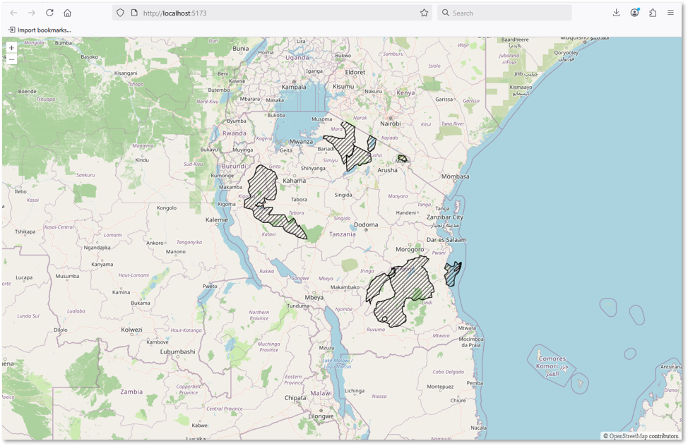

Now that your webmap includes the desired WMS layer, you will adjust the map so that Tanzania is visible when the application opens.


## 3.1. Set the initial map view

- [ ] Open `main.js` and locate the map configuration, beginning with `const map = new Map({`.

- [ ] Inside this configuration, find the `view` property. The OpenLayers `view` determines the default centre, zoom level and projection of the map.

- [ ] Replace the existing centre and zoom values with the values provided below. The `centre` coordinates represent a point approximately at the center of Tanzania, and the slightly increased `zoom` parameter brings the default map view a bit closer than previously.

```javascript
const map = new Map({
  layers: layers,
  target: 'map',
  view: new View({
    center: [3862074, -732904],
    zoom: 6,
  }),
});
```

Save `main.js` and refresh the webmap. The map should now open over Tanzania, with the *Tanzania World Heritage and Ramsar Sites 2026* layer visible. 


## 3.2. Adjust the map window

The map's initial centre and zoom control what you see, but they do not determine how much screen space the map occupies.

- [ ] Open `style.css`. We will use CSS to make the map fill the browser window, instead of just half of it. 
- [ ] Add the code below that defines the map window to be full screen. There is nothing much in the `style.css` file yet, so add this block just at the end of the existing code. 

``` css
#map {
  position: absolute;
  top: 0;
  left: 0;
  bottom: 0;
  right: 0;
}
```

Save the `style.css` file and refresh the map. You should now see a full-window map rather than a map restricted to a smaller area of the page.




## 3.3. Keep the HTML and CSS organised

- [ ] Open `index.html` and inspect the document's `<head>` section.

You see that the map's appearance has already been defined inside the `<style>` element. This works, but as the webmap becomes more complex, it is easier to manage the appearance in a separate stylesheet.

- [ ] Remove the existing inline map styling and add a link to `style.css` inside the `<head>` element:

```html
!DOCTYPE html>
<html lang="en">
  <head>
    <meta charset="UTF-8">
    <title>Tanzania forest reserves and conservation areas</title>

    <!-- This is custom stylesheet that refers to our style.css file -->
    <link rel="stylesheet" href="style.css">
  </head>
```

The browser will now load the map's styling from `style.css`. This keeps the HTML responsible for the page structure and the CSS responsible for its appearance.

- [ ] You can also change the HTML `<title>` to a meaningful name for your webmap. For example: *"Tanzania forest reserves and conservation areas"*. This text appears in the browser tab; it is separate from a title displayed inside the map itself.

Save the file and refresh the application.

::: {.callout-note}
## Checkpoint

Your webmap should now:

- Open with Tanzania in view.
- Fill the available browser window.
- Load its styles from `style.css`.
- Display the correct project title in the browser tab.
:::


## Further reading

- [OpenLayers Basic Concepts](https://openlayers.org/doc/tutorials/concepts.html)
- [OpenLayers Quick Start](https://openlayers.org/doc/quickstart.html)


