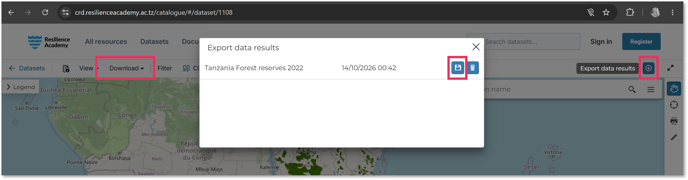
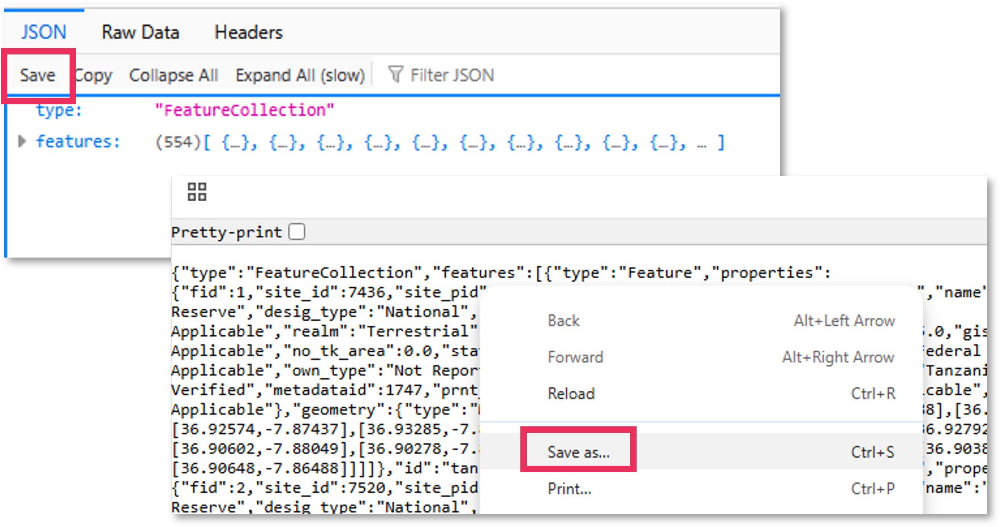
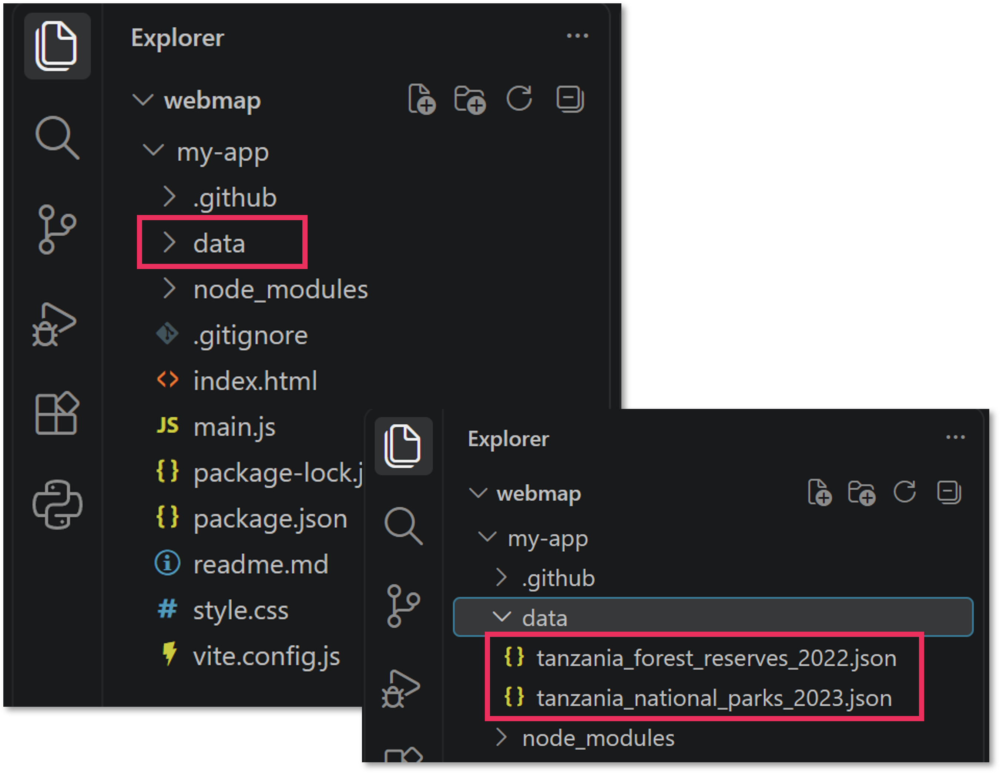
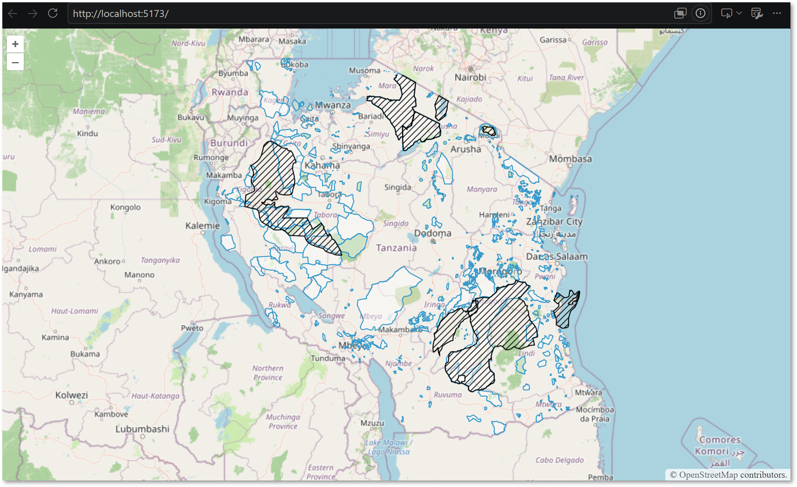

So far, your webmap displays a basemap and a WMS layer from a remote server. In this chapter, you will add two local vector datasets in GeoJSON format. **By the end of the chapter, your map will contain the OpenStreetMap basemap, a WMS layer and two GeoJSON layers.**

Unlike the WMS layer, which is rendered remotely as an image, these GeoJSON files are stored in your project folder and loaded locally by OpenLayers.


## 4.1. Download the datasets

- [ ] Create a folder called `data` inside your webmap project folder, i.e. `your-webmap-folder/my-app/data`.

We will use two more datasets from the [Climate Risk Database](https://crd.resilienceacademy.ac.tz/). Open the following dataset pages:

- [Tanzania Forest Reserves 2022](https://crd.resilienceacademy.ac.tz/catalogue/#/dataset/1108)
- [Tanzania National Parks and Conservation Areas 2023](https://crd.resilienceacademy.ac.tz/catalogue/#/dataset/1105)

For each dataset:
- [ ] Open the dataset page.
- [ ] Choose **Download → Export Data → GeoJSON**.
- [ ] Save the exported file in your project's `data` folder.
- [ ] Rename the files exactly as follows:

- `tanzania_forest_reserves_2022.json`
- `tanzania_national_parks_2023.json`



If your browser opens the exported data as text in a new tab, use the browser's save option or right-click the page and save the raw file.



Your project folder should now contain a structure similar to this:



::: {.callout-note}
## Checkpoint

Make sure both files are saved in the correct folder. Open each file in your editor (or in QGIS!) and check that it contains geographic data rather than an HTML error page or just a download message.
:::

## 4.2. Import the required OpenLayers modules

- [ ] Open `main.js`. At the top of the file, add the three imports below alongside your existing imports:

```javascript
import VectorSource from 'ol/source/Vector.js';
import GeoJSON from 'ol/format/GeoJSON.js';
import VectorLayer from 'ol/layer/Vector.js';
```

These modules have separate roles:

- `GeoJSON` reads data in GeoJSON format.
- `VectorSource` loads and stores the vector features.
- `VectorLayer` displays those features on the map.

Do not delete your existing imports for the basemap or WMS layer.


## 4.3. Add the GeoJSON layers to the map

- [ ] Find the `layers` array (list of layers) in `main.js`, starting with `const layers = [ ]`. Currently, it only contains the basemap and the WMS layer that was added in [Chapter 2](https://utu-geospatial-labs.github.io/openlayers-tutorial/02-wms-layer.html).
- [ ] Add the following layer after the OpenStreetMap and before the WMS layer: 

```javascript
new VectorLayer({
    source: new VectorSource({
      format: new GeoJSON(),
      url: './data/tanzania_forest_reserves_2022.json'
    })
  }),
```
- [ ] Repeat the process for the other GeoJSON layer in your `data` folder - `tanzania_national_parks_2023.json`
- [ ] Save `main.js` and view the changes.



::: {.callout-note}
The file paths must match your folder structure and filenames. For example, `./data/example.json` refers to a file called `example.json` inside `data` folder. `./` can be used as a shortcut to tell that the `data` folder is in the same parent folder as the the `main.js` file. If you used different folder or layer file names, use those instead.
:::

## Layer order in the code vs. the webmap

OpenLayers draws layers in the order in which they are listed: layers later in the array are drawn over layers earlier in the array. For this exercise, use this order:

1. OpenStreetMap basemap
2. Forest reserves GeoJSON
3. National parks and conservation areas GeoJSON
4. WMS international conservation areas


## View the full list of layers in `main.js` by expanding the code below

<details>
<summary>View the edited `main.js` file</summary>

```javascript
main.js

const layers = [
  new TileLayer({
    source: new OSM(),
  }),

  new VectorLayer({
    source: new VectorSource({
      format: new GeoJSON(),
      url: './data/tanzania_forest_reserves_2022.json'
    })
  }),

  new VectorLayer({
    source: new VectorSource({
      format: new GeoJSON(),
      url: './data/tanzania_national_parks_2023.json'
    })
  }),

  new ImageLayer({
    extent: [3228700, -1381359, 4567834, -162868],
    source: new ImageWMS({
      url: 'https://crd.resilienceacademy.ac.tz/geoserver/wms',
      params: {
        'LAYERS': 'geonode:tanzania_international_conservation_areas_2026'
      },
      ratio: 1,
      serverType: 'geoserver',
    }),
  })
];
```

</details>


::: {.callout-note}
## Checkpoint

Your map should now contain the basemap, the WMS layer and both local GeoJSON layers. The vector layers may not yet be easy to distinguish because we have not styled them.

If a layer is missing, check:

- The file exists in the `data` folder.
- The filename and path in the code match the actual file.
- The file contains valid GeoJSON.
- The required OpenLayers imports are present.

:::


[Next: Style vector layers →](05-vector-styles.qmd)
