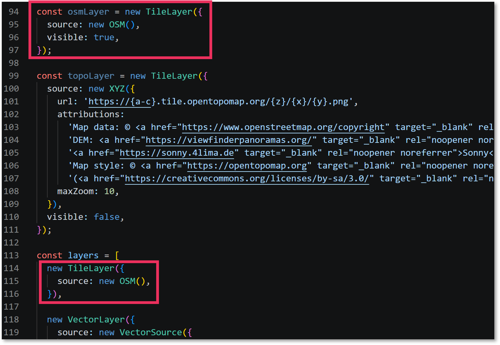
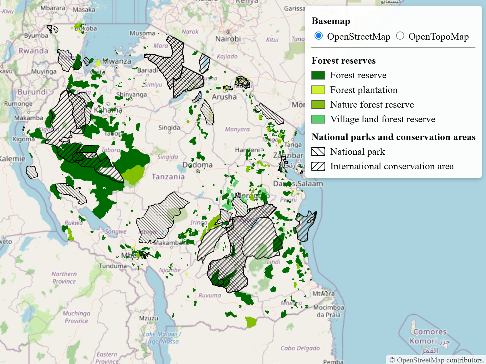

You will add a topographic basemap and let users switch between it and OpenStreetMap using radio buttons in the legend.

The topographic basemap used in this exercise is the [OpenTopoMap](https://wiki.openstreetmap.org/wiki/OpenTopoMap), which is free and open basemap, created in collaboration by various data providers. Correct attribution is as important for this basemap, as it is for OpenStreetMap. You will code all needed attributions while you add the topographic map to your webmap via XYZ tiles. 

::: {.callout-note}
OpenTopoMap can be used under CC-BY-SA license, which means you can use the resource in any (reasonable-size) project with proper attributions, and by sharing it in the same format, wihtout modifications.
:::

## 7.1. Define the two basemap layers

- [ ] Open `main.js`. Add one more import after the other imports:

```javascript
import XYZ from 'ol/source/XYZ.js';
```

- [ ] Find the existing **OpenStreetMap** layer in your `layers` array. 

Instead of configuring the basemaps inside the `layer` array, we will configure them separately. This allows to define unique references for them, which makes your life much easier when configuring the **Layer Switcher** later. 

- [ ] Right above the `const layers = [ ]` code, define the `OpenStreetMap` layer:

```javascript
const osmLayer = new TileLayer({
  source: new OSM(),
  visible: true,
});
```

- [ ] Immediately after it, define the topographic layer:

```javascript
const topoLayer = new TileLayer({
  source: new XYZ({
    url: 'https://{a-c}.tile.opentopomap.org/{z}/{x}/{y}.png',
    attributions:
      'Map data: © <a href="https://www.openstreetmap.org/copyright" target="_blank" rel="noopener noreferrer">OpenStreetMap contributors</a> | ' +
      'DEM: <a href="https://viewfinderpanoramas.org/" target="_blank" rel="noopener noreferrer">SRTM</a>, ' +
      '<a href="https://sonny.4lima.de" target="_blank" rel="noopener noreferrer">Sonny</a> | ' +
      'Map style: © <a href="https://opentopomap.org" target="_blank" rel="noopener noreferrer">OpenTopoMap</a> ' +
      '(<a href="https://creativecommons.org/licenses/by-sa/3.0/" target="_blank" rel="noopener noreferrer">CC-BY-SA</a>)',
    maxZoom: 10,
  }),
  visible: false,
});
```

The `visible` setting controls which basemap is displayed when the map opens. OpenStreetMap is visible by default; the topographic layer starts hidden.




## 7.3. Update the layer list

- [ ] In the `layers` array, **replace the original inline OpenStreetMap layer with the two named layers.** Keep the thematic layers in their existing order. The beginning of the array should now look like this:

```javascript
const layers = [
  osmLayer,
  topoLayer,

  // Keep the forest-reserve, national-parks and WMS layers here as they were.
];
```

- [ ] Save `main.js`.


## 7.4. Add radio buttons to the legend

- [ ] Open `index.html`.
- [ ] Add the following controls to the top of the existing legend, before the thematic legend items (**note** that this code snippet shows some existing legend configuration for your reference):

```html
<!-- Map legend -->
      <div id="legend">

        <!-- Basemap selection -->
        <p><strong>Basemap</strong></p>

        <label class="basemap-option">
          <input type="radio" name="basemap" value="osm" checked>
          OpenStreetMap
        </label>

        <label class="basemap-option">
          <input type="radio" name="basemap" value="topo">
          OpenTopoMap
        </label>

        <hr>

        <!-- Forest reserve layers -->
        <p><strong>Forest reserves</strong></p>

        <div class="legend-item">
          <span class="legend-swatch forest-reserve"></span>
          Forest reserve
        </div>
```

- [ ] Save `index.html`.




## 7.5. Connect the controls to the map

- [ ] Go back to `main.js`.
- [ ] Add the code below to the very end of the file, after `const map = new Map({ })`:

```javascript
// Toggle visibility between OSM and OpenTopoMap
document.querySelectorAll('input[name="basemap"]')
  .forEach((radio) => {
    radio.addEventListener('change', () => {
      osmLayer.setVisible(radio.value === 'osm');
      topoLayer.setVisible(radio.value === 'topo');
    });
  });
```

When a radio button changes, `setVisible()` shows the selected basemap and hides the other. The thematic layers remain visible because the controls only change the visibility of the two basemap layers.

- [ ] Save `main.js` and check your webmap application that everything works.

::: {.callout-note}
## Checkpoint

- [ ] OpenStreetMap is selected when the map opens.
- [ ] Selecting **OpenTopoMap** changes the basemap.
- [ ] Selecting **OpenStreetMap** switches back.
- [ ] The thematic layers remain visible on both basemaps.
- [ ] Attributions are visible in the bottom-right corner for both basemaps.

If your webmap appears blank, the issue is most likely in the configuration of the OpenStreetMap or OpenTopoMap layers. 
:::


[Next: Add a map title →](08-title.qmd)
