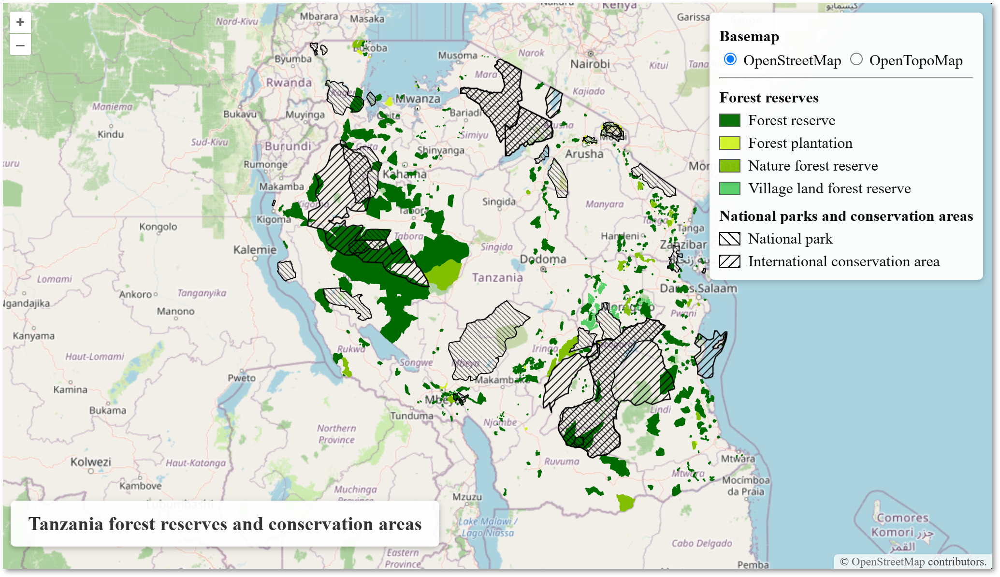

You will add a visible title to the map. The title should tell users what the map is about without taking up too much space.

If you remember, the browser-tab title is set in `index.html`'s `<title>` element. In this chapter, we add a separate heading that appears directly on the map.


## 8.1. Add the title in HTML

- [ ] Open `index.html`.
- [ ] Locate the map container `<div id="map class="map">`, and add the following code right below it, before the legend. Again, this element must be **inside** the map container, on the same inline level as the legend.

```html
<body>
    <div id="map" class="map">

      <!-- Map title -->
      <h1 class="map-title">
        Tanzania forest reserves and conservation areas
      </h1>
```

- [ ] Save `index.html`.


## 8.2. Style the title with CSS

- [ ] Open `style.css` and add the code below to the end of the file:

```css
/* ----------------------------------------
    Map title
---------------------------------------- */
.map-title {
  position: absolute;
  bottom: 10px;
  left: 10px;
  z-index: 1000;
  background: rgba(255, 255, 255, 0.95);
  padding: 12px 18px;
  border-radius: 5px;
  box-shadow: 0 2px 6px rgba(0, 0, 0, 0.25);
  font-size: 20px;
  font-weight: bold;
  color: #333;
}
```

All the style parameters are free to be modified. Try out different parameters to style the title - and other elements - so that you are pleased with them.

- [ ] Save `style.css` and view your webmap. The title should now be in the lower-left corner.
- [ ] Switch between the basemaps and check that the title stays readable.
- [ ] If the title overlaps another control on a small screen, you can adjust its position or font size.





::: {.callout-note}
## Checkpoint

- [ ] The title appears inside the map, not in the browser tab.
- [ ] The title is readable on both basemaps.
- [ ] It does not cover important map content or collide with another control.
:::

[Next: Add an information panel →](09-info-panel.qmd)
