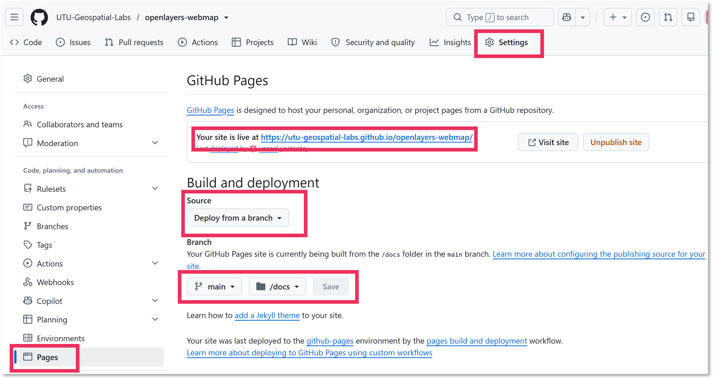

In this final chapter, you will deploy a production version of your OpenLayers application and publish it with GitHub Pages. When finished, you will have a public URL that others can open without running your development server to view your webmap.

We follow the OpenLayers [Quick Start guide](https://openlayers.org/doc/quickstart.html) to deploy the production version, with some additional tweaks. **Pay close attention to those minor changes to make sure your webmap application can be hosted on GitHub Pages.**

## 10.1. Check the project before publishing

Before deployment:

- [ ] Run the webmap locally and test every feature.
- [ ] Check both basemaps.
- [ ] Open and close the information panel.
- [ ] Check the legend, title and layer visibility.
- [ ] Confirm that all data files load and that no errors appear in the browser console.
- [ ] Check attribution, data licences and the terms of any basemap provider.
- [ ] Remove temporary code, unused snippets and personal information.


## 10.2. Change assets directory path

Before building the application, modify `vite.config.js` file. 

- [ ] Replace all of the existing code with this:

``` javascript
import { defineConfig } from 'vite';

export default defineConfig({
  base: './',
});
```

- [ ] Save.

Originally, the app refers to its internal assets with path `/assets/internal-resource.something`, where the `assets` is a sub-folder of the deployed app's root folder. However, GitHub Pages does not read this correctly, but the path should be defined as `./assets/internal-resource.something`. This is changed with the above code.


## 10.3. Deploy the application

- [ ] Open terminal in the `my-app` folder, if not already (revisit the first commands in OpenLayers [Quick Start guide](https://openlayers.org/doc/quickstart.html) to change the target folder, if needed) 
- [ ] Run in terminal:

```bash
npm run build
```
**It may take some seconds for the the build to start**

The build tool (*Vite* in the standard OpenLayers Quick Start project) creates a production-ready version of the application, in a folder called `dist/`. The folder contains an index.html file and required assets to host and display your webmap online.

**Examine the folder contents - you will find `.css` and `.js` files, too.**


## 10.4. Change folder name

The folder name `dist` is not handy for hosting the webmap in GitHub. To make your life much easier, rename the folder to `docs`.


## 10.5. Add data folder

The local GeoJSON files are not automatically added to the production-ready folder. Add your existing `data` folder inside the `docs` folder. Make sure your two `.json` layers are still there, intact. 


## 10.6. Publish with GitHub Pages

GitHub Pages serves static files from a repository or a deployment artifact. Use the deployment method configured for your course repository.

- [ ] If not already, create a new repository in GitHub for your webmap. You may call it e.g. *my-first-webmap*, *openlayers-webmap*, *tanzania-forest-reserves-webmap*, or whatever you prefer. 

- [ ] Upload or push the `docs` folder with all its contents to the `main` branch of you repository.
- [ ] Open the repository on GitHub and go to **Settings → Pages → Build and deployment**.
- [ ] Configure the source of your GitHub Page:

Source: `Deploy from a branch`
Branch: `main`
Folder: `/docs`

- [ ] Save. Wait for the workflow to finish successfully. This may take few minutes. Refresh settings page after a while to check whether the Pages is ready. If yes, you will see a link to view the site - your live webmap!




The source code of the webmap created in this tutorial can be found from UTU Geospatial Labs repository called `openlayers-webmap`: [https://github.com/UTU-Geospatial-Labs/openlayers-webmap](https://github.com/UTU-Geospatial-Labs/openlayers-webmap)

Similarly, the GitHub Pages deployed from that repository can be found here: [https://utu-geospatial-labs.github.io/openlayers-webmap/](https://utu-geospatial-labs.github.io/openlayers-webmap/)


As a final check, compare your published result with the [finished example webmap](https://utu-geospatial-labs.github.io/openlayers-webmap/).


## Common deployment problems

| Problem | What to check |
|---|---|
| A blank map or JavaScript error | Check the browser console and the Actions build log. |
| GeoJSON layers are missing | Confirm the files are included in the built output at the same relative paths used in `main.js`. |
| The map works locally but not at the Pages URL | Check the build output and any repository subpath/base-path configuration. |
| Changes do not appear | Confirm the latest deployment succeeded, then reload the page without using the browser cache. |


## Congratulations!

You have built a webmap that combines remote WMS data and local GeoJSON, styles vector features, includes a legend and basemap switcher, and provides a title and information panel. You have also published a production build online.

The same workflow can be adapted to other datasets and topics. Start by changing the data, then update the styles, legend, title and information text so that they accurately describe your own map.

